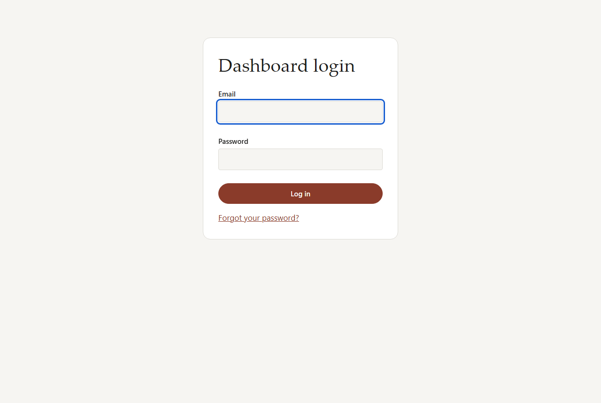
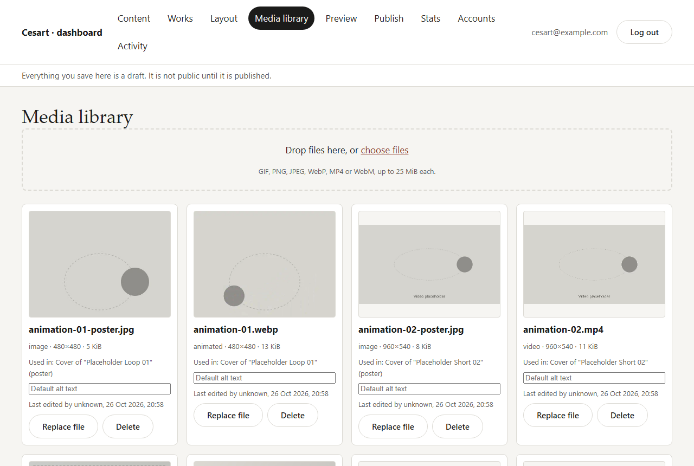
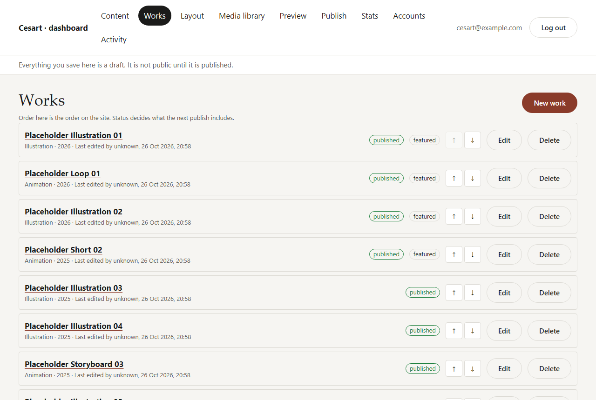
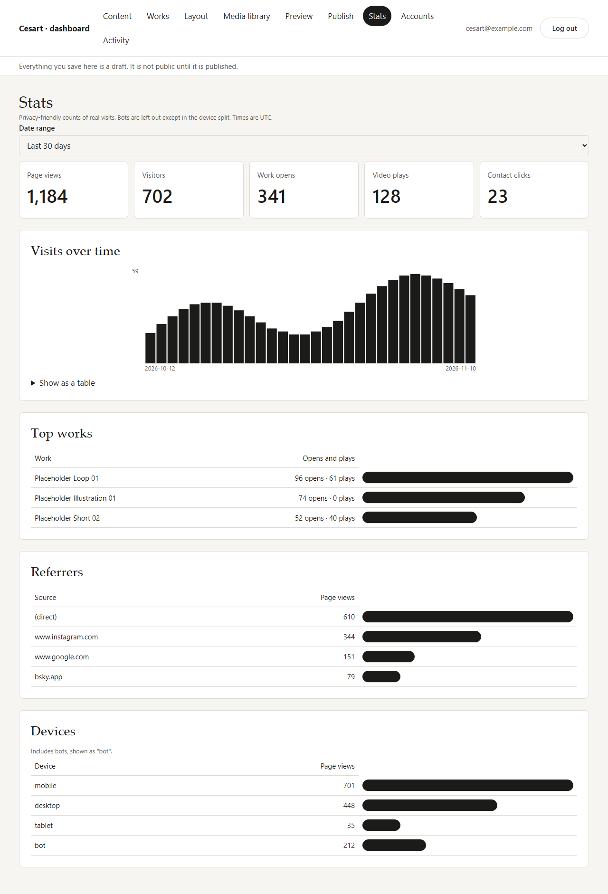
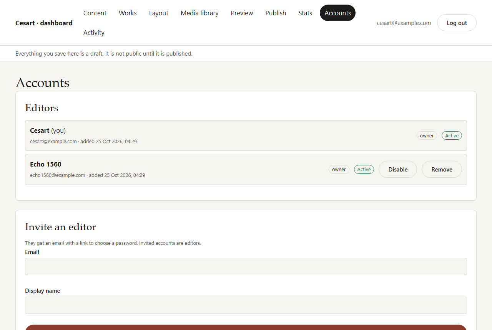

# Editing your site

This guide is for Cesart and the other editors. It shows how to change the portfolio yourself: texts, pictures, sections, pages and the whole look of the site. You never need to touch code.

The editor is at **https://echo1560.github.io/CesartPortfolio/admin/**. Nothing on the public site links to it, so bookmark it.

**The one rule to remember:** everything you change is a **draft**. It is saved for you as you go, but visitors only see it after you click **Publish**. So you can try things, undo them, and publish when you are happy.

## Logging in

1. Open the editor address above.
2. Enter your email and password, then click **Log in**.

You stay logged in on that browser until you choose **Account → Log out**.

There is no "sign up" button. Only someone invited by an owner can log in. If you see *"This account does not have dashboard access"*, your account was disabled or removed. Ask an owner.

## The editor at a glance

After logging in you see your home page, exactly as visitors will see it, with a bar across the top:

| In the top bar | What it does |
|---|---|
| **Page** list | Switch to another page of the site. |
| **D / T / M** | Show the page at desktop, tablet or phone width. |
| **↶ / ↷** | Undo and redo (also Ctrl+Z and Ctrl+Shift+Z). |
| **All changes saved** | Your changes save themselves about a second after you stop. If it says *Unsaved changes…* or *Saving…*, give it a moment. |
| **Site styles** | Colours, fonts, buttons and spacing for the whole site. |
| **Preview** | Hides the editing tools so you see the page as a visitor would. Click **Back to editing** to return. |
| **Publish** | Puts all your drafts on the live site, and shows its progress. |
| **Account** | Your other tools: Pages and navigation, Works, Site settings, Media library, Stats, Activity, Accounts, Publish history, and Log out. |

Under the top bar is the **text formatting** bar. On the right is the **side panel**, which shows the settings of whatever you clicked.

## Editing text

Click any text on the page (a heading, a paragraph, a caption) and type. That is all.

- **Bold** and *italic*: select words, then click **B** or **I** (or Ctrl+B / Ctrl+I).
- **Link:** select words, click **Link**, type the address and click **Apply**. Web addresses need `https://`. Email links start with `mailto:`. **Remove link** takes it off again.
- **Headings and lists** (in longer texts): **H2**, **H3**, **H4**, **¶** (normal paragraph), **•** (bulleted list) and **1.** (numbered list).
- In a one-line text, such as a title, **Enter** finishes editing.
- Pasted text arrives as plain text. Use the buttons to format it again.
- **Esc** finishes editing and clears the selection.

## Pictures, GIFs and videos

Click a picture on the page. The side panel shows it with these options:

- **Replace…** opens your media library. Pick a file, or upload a new one there.
- **Alt text:** one short sentence describing what is in the picture, for people who use screen readers. For example: *"A red fox curled up in falling leaves"*. It is required. If a file has a **default alt text** in the media library, that is used when you leave this empty.
- **Videos** also need a **poster image**: a still frame shown before the video plays.

Double-click a picture to open the library straight away.

### Uploading files

Upload in the **Media library** (Account menu), or from the library window that opens when you replace a picture.

**Allowed files:** GIF, PNG, JPEG, WebP, MP4 and WebM, up to **25 MB** each.

- **Illustrations:** export JPG or PNG at **at least 2000 px** on the long side. The site makes the smaller sizes itself.
- **GIFs and animated WebP:** upload them as they are. When the site is published, they are turned into small, sharp video files that load much faster. The original GIF is kept as a fallback. You do not need to do anything.
- **Videos (MP4 or WebM):** add a poster image (a JPG still frame) too.

In the Media library you can also set a file's **default alt text**, **Replace file** (it changes everywhere the file is used, at the next publish), and **Delete** a file nobody uses any more. If a file is still in use, the library tells you where.

Uploads stay private until you publish.

## Sections

A page is a stack of **sections**: a hero, a gallery, an about block and so on.

- **Add a section:** hover between two sections and click the round **+**, or click **Add a section** in the side panel when nothing is selected. Pick a type. It arrives with example content that you then click and edit.

  | Section | What it is |
  |---|---|
  | Hero | A big opening with a heading, a line of text and an image. |
  | Text | Headings, paragraphs and more, in one column. |
  | Image / GIF | One picture or animation, with an optional caption. |
  | Gallery grid | Your works in a grid, with category filter buttons. |
  | Featured works | A handpicked selection of works. |
  | About | A heading, your story and a portrait. |
  | Contact | Your email and social links. |
  | Columns | 2 to 4 columns holding text, pictures and buttons. |
  | Spacer | Empty space, with an optional line. |
  | Call to action | A short message and a button. |
  | Works list | Your works as rows or cards. |

- **Change a section:** hover it (or click it) to show its toolbar. You can drag it by its handle, move it up or down, duplicate it, open its settings, or delete it. The same buttons are in the side panel. **Alt+↑** and **Alt+↓** move the selected section with the keyboard.
- **Deleted by mistake?** Click **Undo** in the message that appears, or press Ctrl+Z.

### Section settings

Click a section and the side panel shows its settings:

- **Layout variant:** several looks for the same section, for example a gallery as a masonry or a regular grid.
- **Alignment, width and spacing.**
- **Background:** a colour scheme or a background image.
- **Columns:** how many, for Columns and gallery sections.
- **Show on:** hide a section on desktop, tablet or phone. A section hidden everywhere stays in the editor (faded) but visitors never see it.
- **Anchor:** a short name such as `contact`, so a menu link can jump to this section.

**Which works appear:** for a gallery, featured or works list section, choose **All works**, **By category**, **By tag**, or pick works by hand, and how to sort them. Featured works keep the order you give them.

### Blocks

**Text** and **Columns** sections hold **blocks**: heading, paragraph, image/GIF, button, divider, spacer, quote and video. Click **+ Block** under a column (or **Add a block** in the panel) to add one. Drag a block by its handle to move it, also into another column, or use the arrows. Click a button block to change its label, its link and its style in the panel.

## Pages and the menu

Open **Account → Pages and navigation**.

- **New page:** click **Add a page**, choose a starting point (**Blank**, **About**, **Commissions**, **Process** or **Contact**), give it a **Page name**, and click **Create page**. The **address** (for example `commissions` → `…/CesartPortfolio/commissions/`) is suggested from the name. Use lowercase letters, numbers and dashes.
- **Edit** a page to rename it, change its address, or set its **Status**:
  - **Published:** on the site after the next publish.
  - **Draft:** being worked on, not on the site.
  - **Hidden:** kept, but not on the site.
- **Search and sharing:** an **SEO title** and **SEO description** for search engines, and a **Social image** shown when someone shares the page. Leave them empty to use the site defaults (see Site settings).
- **Duplicate** copies a page with all its sections. **Delete page** removes it. Use ↑ ↓ to reorder the list.
- **Home page:** **Make home** makes another page the front page. The home page cannot be hidden or deleted; make another page the home page first.
- Changing the address of a published page breaks links people have shared, so the editor asks first.

**Navigation menu:** the links in the site header, in order. Add a page, a section of a page (an anchor), a work or an outside address. A link can open a dropdown with one more level of links. Click **Save navigation**.

**Footer:** the footer text, footer links, social links and the copyright line. Click **Save footer**.

Pages and menu changes are drafts too, until you publish.

## Site styles

Click **Site styles** in the top bar. Every change shows on the page right away and applies to the whole site.

- **Theme presets:** ready-made looks. Pick one, then adjust it. **Reset to preset** undoes your adjustments; **Reset to default** goes back to the original Classic look.
- **Colours:** background, text, accent, buttons, links and more. You can also add separate **dark mode colours**.
- **Typography:** heading and body fonts (a curated set of free fonts that the site serves itself), weights, sizes, line height, letter spacing and heading case.
- **Buttons, links and shape:** filled, outline or pill buttons, corner radius, link colour and underline.
- **Spacing:** compact, medium or roomy.
- **Animations:** turn the reveal and hover effects on or off. Visitors who asked their device for less motion never get them anyway.

If two colours are too close to read easily, a **Low contrast** warning appears and names the pair. Fix it before publishing, so everyone can read your site.

**Undo style change** steps back one change at a time.

## Works

Your illustrations and animations live in **Account → Works**. They feed the gallery, featured and works list sections, and each work gets its own page.

- **New work:** click **New work**, fill in the title, category, year, description and tags, choose the cover, and click **Create work**.
- **Edit:** click **Edit**, change it, then **Save work**.
- **Slug:** the short name in the work's address (for example `fox-poster` → `…/work/fox-poster/`). It cannot change after the work is created, so shared links keep working.
- **Status:**
  - **Published:** on the site after the next publish.
  - **Draft:** kept in the editor only.
  - **Archived:** hidden everywhere. Safer than deleting if you might want it back.
- **Gallery:** extra pictures or clips shown on the work's own page.
- **Featured:** marks the work for a featured section that has no hand-picked works.
- Use ↑ ↓ to set the order of works on the site.

## Site settings

**Account → Site settings** holds the details used across the whole site:

- **Page title, description, author and language:** the defaults for search engines and sharing.
- **Social share image:** the picture shown when someone shares a page that has no image of its own. It is required.
- **Contact email:** used when you add a new contact section. A contact section already on a page keeps its own email; click it in the editor to change it.
- **Social links:** a name and a full address (starting with `https://`) for each. Contact sections and the footer show them.
- **Categories:** the filter buttons of the gallery. At least one must stay, and every work belongs to one.

Each box has its own **Save** button.

## Previewing and publishing

**Preview** in the top bar shows the current page without the editing tools. Use the **D / T / M** buttons to check it at phone and tablet size, and the **Page** list to check other pages. Click **Back to editing** when done.

**Publish:**

1. Click **Publish** in the top bar. Any change still being saved is saved first.
2. Next to the button, the status shows **Queued**, then **Running**, then **Success**. It takes about 1–2 minutes and updates by itself.
3. Open the live site to check. If the page looks old, reload it (Ctrl+F5, or Cmd+Shift+R on a Mac).

Good to know:

- Only one publish runs at a time. The button waits until the previous one has finished.
- If a publish **fails**, the live site does not change: it stays on the last good version. The message says what went wrong. Usually a picture is missing its alt text, or a video its poster. Fix it and publish again. If it keeps failing, send the message to Echo.
- **Account → Publish history** lists every publish, who started it and when.

### Restoring an earlier version

Every successful publish is kept as a **version**. If you want the site back the way it was:

1. Open **Account → Publish history**.
2. Find the version by its date and click **Restore**.
3. Confirm. This copies that version's pages, sections, menu, footer and styles back into your **draft**. It does not change the live site yet.
4. Look over the pages in the editor, then click **Publish**.

Restoring never deletes anything. Pages that were published since then become **Hidden**, so you can bring them back. Works, categories, social links and your media library are not changed. (If you do not see a **Restore** button yet, ask Echo: it is being added.)

## Reading stats

Open **Account → Stats** and pick a **Date range** (last 7, 30 or 90 days, or a custom range up to 400 days). Days are counted in UTC time.

| Number | Meaning |
|---|---|
| **Page views** | Pages opened on the site. |
| **Visitors** | Different people per day. Someone who comes back on another day counts again. |
| **Work opens** | A work was opened (in the pop-up or on its own page). |
| **Video plays** | A video was started. |
| **Contact clicks** | The email button or a social link was clicked. |

Below that: **Visits over time** (click **Show as a table** for the exact numbers), **Top pages**, **Top works**, **Referrers** (the websites visitors came from; *(direct)* means a typed address, a bookmark or an app that does not say where it came from) and **Devices** (phone, computer, tablet).

Search engines and other robots are left out of the numbers, except in Devices, where they show as "bot". The stats are privacy-friendly: there are no cookies, and visitors cannot be identified or followed from one day to the next.

Events older than 400 days are deleted by hand, about once a year. Echo runs it as described in [GO-LIVE.md → Maintenance](GO-LIVE.md#maintenance).

## Inviting an editor

Only **owners** can do this.

1. Open **Account → Accounts**.
2. Under **Invite an editor**, enter their email and the name to show, then click **Send invitation**.
3. They get an email with a link. The link opens the editor and asks them to **choose a password** (at least 10 characters). Then they are logged in.

New people join as **editors**. Editors can do everything in this guide except manage accounts. The invitation link only works for a limited time (one day on the live site) and only once. If it expired, remove the person and invite them again.

To take access away, an owner can click **Disable** (it can be undone with **Enable**) or **Remove** (deletes their login). You cannot disable or remove yourself, and there must always be at least one owner.

**Account → Activity** lists who changed what, and when.

## Resetting a password

**Forgot your password:**

1. On the login page, click **Forgot your password?**
2. Enter your email and click **Send reset link**.
3. Open the email and click the link. Choose a new password (at least 10 characters), repeat it, and click **Save password**.

For safety, the page always says *"a reset link is on its way"*, even when the email is not an editor's.

**Change your password while logged in:** open **Account → Accounts**, fill in **Change password**, and click **Change password**. If you logged in more than a day ago, you get an emailed code first. Enter the code and click **Change password** again.

## Keyboard shortcuts

| Keys | Does |
|---|---|
| Ctrl+Z / Ctrl+Shift+Z (or Ctrl+Y) | Undo / redo |
| Ctrl+S | Save now (it also saves by itself) |
| Ctrl+B / Ctrl+I | Bold / italic, while editing text |
| Alt+↑ / Alt+↓ | Move the selected section or block |
| Esc | Finish editing text, then clear the selection |

On a Mac, use Cmd instead of Ctrl.

## If something goes wrong

- **The save state shows an error:** read it. It says what to fix, for example a missing alt text. Your other changes are safe.
- **A yellow note says someone else changed this page:** another editor saved changes to it after you opened it. The last save wins, so your edits replaced theirs. Reload to see their version.
- **A red message after saving a form:** it names the field to fix. Nothing was saved.
- **"Request failed" or the editor does not load:** check your internet connection and reload. If it keeps happening, tell Echo.
- **The live site did not change after a publish:** check that the page or work is **Published**, that the publish shows **Success**, and reload the page with Ctrl+F5.
