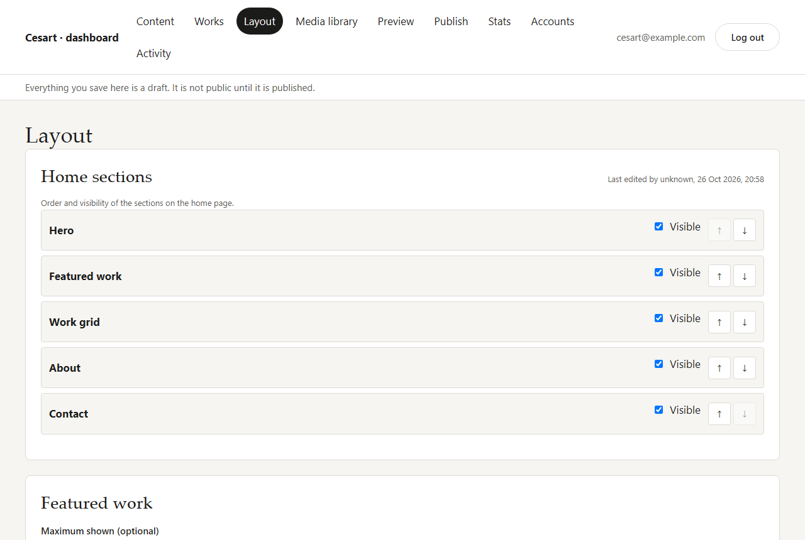
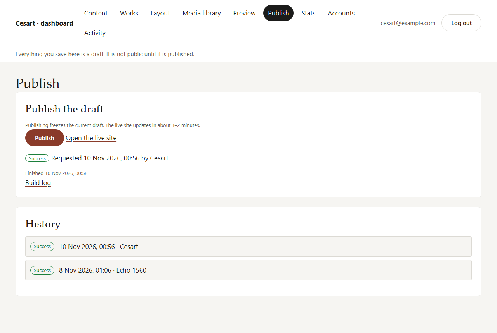

# Dashboard guide

This guide is for Cesart and the other editors. It explains how to change the portfolio without touching code.

The dashboard is at **https://echo1560.github.io/CesartPortfolio/admin/**. Nothing on the public site links to it, so bookmark it.

**The most important rule:** everything you save is a **draft**. Visitors only see it after you click **Publish**. You can edit as much as you like, check it in **Preview**, and publish when you are happy.

## Logging in

1. Open the dashboard address above.
2. Enter your email and password, then click **Log in**.

You stay logged in on that browser until you click **Log out** (top right).

There is no "sign up" button. Only someone invited by an owner can log in. If you see *"This account does not have dashboard access"*, your account was disabled or removed. Ask an owner.

## Finding your way around

The menu at the top has these pages:

| Page | What it is for |
|---|---|
| **Content** | Site texts: the hero (top banner), about, contact and social links, categories, page title and sharing image. |
| **Works** | Your illustrations and animations: add, edit, reorder, hide or delete. |
| **Layout** | The order of the home page sections and which works are featured. |
| **Media library** | All uploaded files: upload, replace, delete, default alt text. |
| **Preview** | How the home page will look with your current draft. |
| **Publish** | Puts the draft on the live site, and shows the history of publishes. |
| **Stats** | Visits, most opened works, where visitors come from. |
| **Accounts** | Who can use the dashboard, invite editors, change your password. |
| **Activity** | A log of who changed what and when. |

Each box shows *"Last edited by … "* so you can see who touched it last.

## Editing content

### Site texts (Content page)

Each box (Hero, About, Contact and socials, Categories, Site settings) has its own **Save** button. Change the fields, then click that box's Save button. You see *"Saved as draft"*.

- **About text** uses Markdown: `**bold**`, `*italic*`, `[link text](https://…)`, and a blank line between paragraphs. A preview appears under the text box.
- **Social links:** click **Add social link**, give it a name and a full address (starting with `https://`).
- **Categories:** at least one must stay. A work must belong to a category, so create the category first.

If a field is wrong (for example an empty required field or a bad address), it turns red with a message and nothing is saved.

### Works (Works page)

- **New work:** click **New work**, fill in the title, category, year, description and tags, choose the cover file, and click **Create work**.
- **Edit:** click **Edit** on a work, change it, then click **Save work**.
- **Slug:** the short name in the work's web address (for example `fox-poster` → `…/work/fox-poster/`). Use lowercase letters, numbers and hyphens. It cannot change after the work is created, so links people shared keep working.
- **Status** decides what the next publish includes:
  - **Published**: on the site after the next publish.
  - **Draft**: kept in the dashboard only. Good for work in progress.
  - **Archived**: hidden everywhere, including the preview. Use this instead of deleting if you might want it back.
- **Gallery:** extra images or clips shown on the work's own page. Click **Add gallery item**.
- **Delete** removes the work for good. Archiving is safer.

### Alt text

Every image and animation needs **alt text**: one short sentence describing what is in the picture, for people who use screen readers. For example: *"A red fox curled up in falling leaves"*. The dashboard will not save a picture without it.

You can set a **Default alt text** on a file in the Media library. It is filled in for you when you use that file, and you can still change it each time you use it.

## Uploading GIFs and illustrations

You can upload in two places:

- **Media library** page: drop files on the box, or click **choose files**. You can upload several at once.
- Directly from a work or the hero: click **Choose file** → **Upload a new file**.

**Allowed files:** GIF, PNG, JPEG, WebP, MP4 and WebM, up to **25 MB** each.

- **Illustrations:** export JPG or PNG at **at least 2000 px** on the long side. The site makes the smaller sizes itself.
- **GIFs and animated WebP:** upload them as they are. The dashboard recognises them as animations. When the site is published, they are automatically converted into small, sharp video files that load much faster. The original GIF is kept as a fallback. You do not need to do anything.
- **Videos (MP4/WebM):** a **poster image** (a still frame, JPG) is required. It is shown before the video plays and for visitors who turned off motion.
- **YouTube or Vimeo:** choose **YouTube or Vimeo embed** as the source and paste the video page address. No upload is needed.

**Replace file** swaps the file everywhere it is used, and the old version disappears from the site at the next publish. It has to be the same kind (image for image, animation for animation, video for video).

**Delete** is only possible when no work, hero or gallery uses the file. If it is in use, the dashboard tells you where. Remove it from there first.

Uploaded files stay private until you publish. Only published files can be seen by visitors.

## Reordering the home page

On the **Layout** page:

- **Home sections:** use the **↑** and **↓** buttons to move a section (Hero, Featured work, Work grid, About, Contact). Untick **Visible** to hide a section without deleting it.
- **Featured work:** pick works from **Add a featured work**, reorder them with ↑ ↓, and remove them with **Remove**. **Maximum shown** limits how many appear.
- **Work grid:** choose columns on phones, tablets and computers, masonry layout, and whether to show the category filter buttons.

Click **Save layout** when done.

The order of works in the grid is set on the **Works** page with ↑ ↓. The order there is the order on the site.

## Previewing and publishing

### Preview

Open **Preview** to see the home page with your current draft. **Refresh preview** reloads it after more edits, and **Phone width** shows it at phone size. The preview includes draft works, so it shows a little more than the next publish would, and archived works are hidden. A yellow note at the top says so.

### Publish

1. Open **Publish** and click **Publish**.
2. The status shows **Queued**, then **Running**, then **Success**. This takes about 1–2 minutes and the page updates by itself.
3. Click **Open the live site** to check. If the page looks old, reload it (Ctrl+F5 / Cmd+Shift+R).

Good to know:

- Only one publish can run at a time. The button waits until the previous one finishes.
- If a publish **fails**, the live site does not change. It stays on the last good version. The message and the **Build log** link explain what went wrong. Usually it is a missing hero image or category. Fix it and publish again. If it keeps failing, send the build log link to Echo.
- **History** lists every publish, who started it and when.

## Reading stats

Open **Stats** and pick a **Date range** (last 7, 30 or 90 days, or a custom range up to 400 days). Days are counted in UTC time.

| Number | Meaning |
|---|---|
| **Page views** | Pages opened on the site. |
| **Visitors** | Different people per day. Someone who comes back on another day counts again. |
| **Work opens** | A work was opened (in the pop-up or on its own page). |
| **Video plays** | A video or embedded clip was started. |
| **Contact clicks** | The email button or a social link was clicked. |

Below that: **Visits over time** (click **Show as a table** for the exact numbers), **Top works**, **Referrers** (the websites visitors came from; *(direct)* means a typed address, a bookmark or an app that does not say where it came from) and **Devices** (phone, computer, tablet).

Search engines and other robots are left out of the numbers, except in Devices, where they show as "bot". The stats are privacy-friendly: there are no cookies, and visitors cannot be identified or followed from one day to the next.

Events older than 400 days are deleted by hand, about once a year. Echo runs it as described in [GO-LIVE.md → Maintenance](GO-LIVE.md#maintenance).

## Inviting an editor

Only **owners** can do this.

1. Open **Accounts**.
2. Under **Invite an editor**, enter their email and the name to show, then click **Send invitation**.
3. They get an email with a link. The link opens the dashboard and asks them to **choose a password** (at least 10 characters). Then they are logged in.

New people join as **editors**. Editors can do everything on this page except manage accounts. The invitation link only works for a limited time (one day on the live site) and only once. If it expired, remove the person and invite them again.

To take access away, an owner can click **Disable** (it can be undone with **Enable**) or **Remove** (deletes their login). You cannot disable or remove yourself, and there must always be at least one owner.

## Resetting a password

**Forgot your password:**

1. On the login page, click **Forgot your password?**
2. Enter your email and click **Send reset link**.
3. Open the email and click the link. Choose a new password (at least 10 characters), repeat it, and click **Save password**.

For safety, the page always says *"a reset link is on its way"*, even when the email is not an editor's.

**Change your password while logged in:** open **Accounts**, fill in **Change password**, and click **Change password**. If you logged in more than a day ago, you get an emailed code first. Enter the code and click **Change password** again.

## If something goes wrong

- **A red message after saving:** read it. It names the field to fix. Nothing was saved.
- **"Request failed" or the page does not load:** check your internet connection and reload. If it keeps happening, the backend may be down. Tell Echo.
- **The live site did not change after a publish:** check that the work's status is **Published**, that the publish shows **Success**, and reload the page with Ctrl+F5.

## Visual editor (v3, TITA-95)

`/admin/` now opens the visual editor (route `#/editor/<page-slug>`); the form pages remain under the account menu until stage 7 retires them. Source: `src/admin/editor/`.

- **Canvas** (`canvas.tsx`): the shared Preact section components rendered with the draft (`build_content_v3(false)`) and the theme CSS into a sandboxed same-origin iframe. Media uses signed Storage URLs.
- **Selection and panel** (`panel.ts`): click a section or block; the panel form is generated from the zod settings schemas via JSON Schema, plus variant, per-device visibility and media/alt controls. Esc deselects.
- **Inline text** (`inline.ts`): headings, captions and paragraphs are `contenteditable`; the DOM is read back into the contract's rich-text JSON (bold, italic, link, h2-h4, lists). No HTML is stored or pasted (paste is plain text).
- **Store** (`store.ts`): one state with undo/redo, debounced autosave (1.2 s) of changed sections and blocks (validated with `sectionDraftSchema` / `blockDraftSchema`; the audit trigger sets `updated_by`), and a notice when another editor changed the same item since load (last write wins).
- **Publish**: flushes the autosave, calls the `publish` function and follows the run with the same status poll as v2.
- Adding/moving/deleting sections and blocks, the page manager and the theme editor arrive in stages 4-6.
