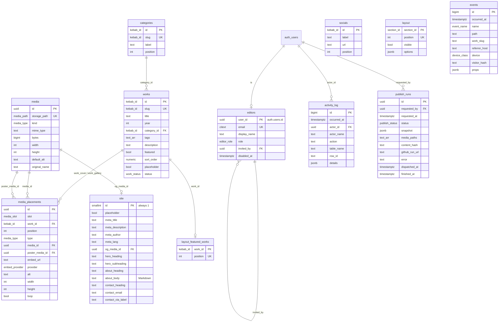

# v2 contracts

The shared contracts for the v2 backend (TITA-72). Every v2 child issue builds against this file. If you need to change a contract, change it here in your PR and note it on TITA-72.

`src/lib/schema.ts` stays the content contract: the database produces exactly that JSON, and the build still runs it through `validateContent`.

Migrations: `supabase/migrations/`. Tests: `supabase/tests/database/` (pgTAP) and `scripts/db-api-smoke.mjs` (API). Rollbacks: `supabase/rollbacks/`.

## 1. Draft and published state

Editors work on **draft tables** (`site`, `socials`, `categories`, `works`, `media`, `media_placements`, `layout`, `layout_featured_works`). The public site never reads them.

**Publish** freezes the draft into a **snapshot**: `create_publish_run()` calls `build_content(true)` and stores the resulting `Content` JSON in `publish_runs.snapshot`. The **live content** is the snapshot of the newest `publish_runs` row whose status is not `failed`. The build reads only that, through `get_published_content()`.

That means:

- An edit is private until someone clicks Publish, even if a code push rebuilds the site in between.
- `works.status` decides which works go into the next snapshot: `published` works are included, `draft` works are not, and `archived` works are hidden from the preview as well.
- The dashboard preview is `build_content(false)`: every non-archived work, from the current draft.
- A failed run never becomes live. The site stays on the previous good snapshot.

## 2. Schema



Every editable table (`editors`, `site`, `socials`, `categories`, `works`, `media`, `media_placements`, `layout`, `layout_featured_works`) also has `updated_at` and `updated_by`. A trigger sets both on every insert and update, so a client cannot forge them. A second trigger writes each insert, update and delete to `activity_log`.

### Enums and domains

| Type | Values |
|---|---|
| `editor_role` | `owner`, `editor`. Both edit all content and publish. **Only active owners manage accounts** (invite, disable, enable, remove), and the last active owner can never be disabled or removed. Invited accounts are always `editor`, and there is no API to promote anyone to owner. The seed makes Cesart and Echo 1560 owners. |
| `work_status` | `draft`, `published`, `archived` |
| `media_type` | `image`, `animated`, `video`, `embed` (same as `Media['type']`) |
| `embed_provider` | `youtube`, `vimeo` |
| `media_slot` | `hero`, `about_portrait`, `work_cover`, `work_gallery` |
| `section_id` | `hero`, `featured`, `grid`, `about`, `contact` (same as `SectionId`) |
| `publish_status` | `pending`, `dispatched`, `building`, `succeeded`, `failed` |
| `event_name` | `page_view`, `work_open`, `video_play`, `contact_click` (same as `TrackEvent`) |
| `device_class` | `mobile`, `tablet`, `desktop`, `bot`, `unknown` |
| `kebab_id` (domain) | `^[a-z0-9]+(?:-[a-z0-9]+)*$`, at most 100 characters (same as `kebabId`) |
| `media_path` (domain) | relative object key: no leading `/`, no `\`, no `..` segment, no URL scheme (same as `mediaPath`) |

### Integrity rules enforced in the database

- `media_placements`: an `embed` has `embed_url` (https), `provider`, `width` and `height`, and no `media_id`. Every other type has a `media_id` whose `media.kind` matches the type. A `video` needs a poster. A poster must be an `image`. There is one `hero`, one `about_portrait` and one `work_cover` per work. Gallery positions are unique per work.
- `media`: `mime_type` is on the allow-list and agrees with `kind`. `bytes` is at most 25 MiB. A file that is still used by a placement or by `site.og_media_id` cannot be deleted (`on delete restrict`).
- `works.category_id` references `categories` (`restrict`). Deleting a work cascades to its placements and its featured entry.
- `layout.options` is shape-checked per section: `featured` → `{limit?}`, `grid` → `{columns?: {sm, md, lg: 1–6}, masonry?, showFilters?}`, others → `{}`. `layout.position` and `layout_featured_works.position` are unique and deferrable, so a reorder can swap positions inside one transaction.

## 3. Mapping rows to `Content` (`src/lib/schema.ts`)

`build_content()` returns `{"site": Site, "works": Work[]}`, the exact input of `validateContent(site, works, mediaExists)`. Optional fields are left out when they are null or false, so the JSON matches the hand-written files. `supabase/tests/database/01_seed_matches_content.test.sql` proves that the seed maps back to `content/*.json` byte for byte (as `jsonb`).

| Content field | Source |
|---|---|
| `site.placeholder` | `site.placeholder` (left out when false) |
| `site.meta.{title,description,author,lang}` | `site.meta_*` |
| `site.meta.ogImage` | `media.storage_path` of `site.og_media_id` |
| `site.hero.{heading,subheading}` | `site.hero_*` |
| `site.hero.media` | the `media_placements` row with `slot = 'hero'` |
| `site.about.{heading,body}` | `site.about_heading`, `site.about_body` |
| `site.about.portrait` | placement `slot = 'about_portrait'` (left out when there is none) |
| `site.contact.{heading,email,ctaLabel}` | `site.contact_heading`, `contact_email`, `contact_cta_label` |
| `site.contact.socials[]` | `socials` ordered by `position` → `{id, label, url}` |
| `site.categories[]` | `categories` ordered by `position` → `{id, slug, label}` |
| `site.layout.sections[]` | `layout` ordered by `position` → `{id: section_id, visible, options?}`. `options` is left out when it is `{}` |
| `…featured.options.workIds` | `layout_featured_works` ordered by `position` (only works included in this build), merged with `layout.options` (`limit`) |
| `works[]` | `works` with `status = 'published'`, ordered by `sort_order` (nulls last), `year` desc, `title` |
| `work.{id,slug,title,year,categoryId,tags,description}` | the same columns (`category_id` → `categoryId`) |
| `work.featured`, `work.placeholder` | the same booleans, left out when false |
| `work.order` | `sort_order` (left out when null) |
| `work.media` | placement `slot = 'work_cover'` |
| `work.gallery` | placements `slot = 'work_gallery'` ordered by `position` (left out when empty) |

A placement becomes a `Media` object like this:

| `Media` field | Source |
|---|---|
| `type` | `media_placements.type` |
| `src` | `media.storage_path` (files) or `embed_url` (embeds) |
| `alt` | `media_placements.alt` (required, not blank) |
| `width`, `height` | `media_placements.width/height` when set, else `media.width/height` |
| `poster` | `media.storage_path` of `poster_media_id` |
| `loop`, `provider` | the same columns |

So a `src` in Content is always a key in the `media` bucket. That keeps `mediaPath` validation and `resolveMedia` unchanged.

## 4. Storage

- **Bucket** `media`, private (`public = false`). Every read goes through RLS.
- **Allowed MIME types**: `image/gif`, `image/png`, `image/jpeg`, `image/webp`, `video/mp4`, `video/webm`. **Size limit**: 25 MiB per file. The Storage API enforces both and returns HTTP 415 or 413.
- **Key convention**: `<folder>/<name>.<ext>`.
  - Dashboard uploads go to `uploads/<uuid>.<ext>`, with a lowercase extension that matches the MIME type. Replacing a file uploads a new key and repoints `media`, so the old URL never serves new content.
  - Files imported from `content/media/` keep their path, for example `placeholder/illustration-01.jpg`.
  - RLS also requires an allowed extension and rejects `..`, a leading `/`, and hidden (`.`) segments (`is_valid_media_key`).
- **Policies**: active editors can select, insert, update and delete in `media`. Anyone, including anon, can select an object only when its key is in the live snapshot's `publish_runs.media_paths` (`is_published_media(name)`). Draft uploads are never public.
- **Upload flow** (admin UI): upload the file to `uploads/<uuid>.<ext>`, then insert the `media` row (`storage_path`, `kind`, `mime_type`, `bytes`, `width`, `height`, `original_name`). Delete the row before deleting the object. The row cannot be deleted while it is in use.

### How the build reads media

With `CONTENT_SOURCE=supabase`, before `astro build`:

1. `get_published_content()` → snapshot.
2. For every key in the snapshot (`src`, `poster`, `ogImage`, skipping embed URLs), download `GET {SUPABASE_URL}/storage/v1/object/authenticated/media/<key>` with the anon key into `content/media/<key>`. `content/media/uploads/` is git-ignored. Imported keys overwrite their identical committed copies.
3. `validateContent` checks that every file now exists. `media.ts` keeps its `import.meta.glob('content/media/**')`, so no URL logic moves out of `media.ts`.

A missing download fails the build.

### Media variants (resolved by `media.ts` at build time)

Variants are generated at build time and are **not stored** in the database or the bucket. For every `animated` GIF (and animated WebP), the pipeline (ffmpeg, as in `scripts/generate-placeholders.mjs`) produces:

| Variant | Format | Notes |
|---|---|---|
| `webm` | VP9, no audio | listed first in `<source>` |
| `mp4` | H.264 (yuv420p, `+faststart`), no audio | |
| `poster` | first frame as an image, run through `resolveImage` | used only when the content gives no `poster` |
| `gif` fallback | the original file, untouched | `` fallback, and the source for reduced motion when there is no poster |

`ResolvedAnimated` gains one field. Everything else stays as it is:

```ts
export interface ResolvedAnimated {
  type: 'animated';
  src: string;            // original GIF / animated WebP (fallback)
  sources: { src: string; mimeType: 'video/webm' | 'video/mp4' }[]; // [] if conversion is not possible
  width: number;
  height: number;
  alt: string;
  loop: boolean;          // default true
  poster?: ResolvedImage; // the content poster, else the generated first frame
}
```

Until the pipeline lands, `media.ts` fills `sources` from sibling files in `content/media/` named `<name>.webm` and `<name>.mp4` (same stem as the GIF). The pipeline should write its output to those paths. With no sibling files, `sources` is `[]` and the component renders the GIF ``. Video playback is started and paused by `src/scripts/media.ts` (visible, hover, reduced motion), not by the `autoplay` attribute, so reduced motion never autoplays.

Components render `sources` as a muted, `playsinline`, looping, script-started `<video>` with the GIF as fallback. Pause-when-off-screen and reduced-motion behaviour stay as in v1.

## 5. RPCs (PostgREST `POST /rest/v1/rpc/<name>`)

Errors use SQLSTATE codes. PostgREST maps `PTxxx` to HTTP `xxx`, and `42501` to 401 or 403.

| Function | Caller | Returns / does | Errors |
|---|---|---|---|
| `get_published_content()` | anon, authenticated | live `Content` JSON, or `null` if nothing has been published | — |
| `is_editor()` | authenticated | `boolean` | — |
| `is_owner()` | authenticated | `boolean`: an active owner (shows or hides the account controls) | — |
| `build_content(p_published_only bool = true)` | editors | draft `Content` (preview with `false`) | `PT422` no site row |
| `create_publish_run()` | editors | the new `publish_runs` row (`pending`) | `42501` not an editor, `PT409` a run is in flight (< 15 min), `PT422` missing hero or categories |
| `update_publish_run(p_id, p_status, p_github_run_url?, p_error?)` | service role | updated row. Finished runs (`succeeded`/`failed`) are final | `PT404`, `PT409` already finished |
| `set_editor_disabled(p_user_id, p_disabled)` | owners | updated `editors` row | `42501` not an active owner, `PT409` last active owner or yourself, `PT404` |
| `remove_editor(p_user_id)` | owners | deletes the `editors` row | `42501` not an active owner, `PT409` last active owner or yourself, `PT404` |
| `register_invited_editor(p_user_id, p_email, p_display_name, p_invited_by)` | service role | new `editors` row with role `editor` | `42501` inviter is not an active owner, `23505` already an editor |
| `record_event(p_name, p_path, p_work_slug?, p_referrer_host?, p_device?, p_visitor_hash?, p_props?)` | service role | `true` stored / `false` rate-limited | `23514` invalid field |
| `purge_old_events(p_keep interval = '400 days')` | service role | rows deleted | — |
| `stats_overview(from, to)` | editors | `page_views, visitors, work_opens, video_plays, contact_clicks` | `42501`, `PT422` bad range |
| `stats_daily(from, to, tz = 'UTC')` | editors | `day, page_views, visitors` for every day, zeros included | `42501`, `PT422` |
| `stats_top_works(from, to, limit = 10)` | editors | `work_slug, title, opens, video_plays` | `42501`, `PT422` |
| `stats_referrers(from, to, limit = 10)` | editors | `referrer_host` (`(direct)` for none), `page_views` | `42501`, `PT422` |
| `stats_devices(from, to)` | editors | `device, page_views` | `42501`, `PT422` |

Stats ranges are half-open `[from, to)` and at most 400 days long. Bots are excluded, except in `stats_devices`. `visitors` counts distinct visitors per day, because the hash rotates daily.

## 6. Edge Functions

All functions live in `supabase/functions/<name>/` (Deno). They answer JSON as `{"ok": true, ...}` or `{"ok": false, "error": {"code": "<code>", "message": "..."}}`. `SUPABASE_SERVICE_ROLE_KEY` is used only inside functions. For editor calls, the function verifies the caller's JWT and checks `is_editor()` with that JWT before using the service role.

CORS: allow `https://echo1560.github.io` and `http://localhost:4321` / `http://127.0.0.1:4321`. `Access-Control-Allow-Headers: authorization, apikey, content-type`.

| Code | HTTP | Meaning |
|---|---|---|
| `bad_request` | 400 | invalid JSON or fields |
| `unauthorized` | 401 | missing or invalid JWT |
| `forbidden` | 403 | not an active editor |
| `not_found` | 404 | unknown run or editor |
| `method_not_allowed` | 405 | |
| `conflict` | 409 | publish in flight, already an editor, acting on yourself |
| `payload_too_large` | 413 | body over the limit |
| `unprocessable` | 422 | content cannot be published |
| `rate_limited` | 429 | (`invite-editor` only) |
| `upstream_error` | 502 | GitHub or Auth admin call failed |

### `track` (public, `verify_jwt = false`)

`POST /functions/v1/track` with the body sent by `navigator.sendBeacon` as `text/plain` JSON (this avoids a CORS preflight). The body is at most 2 KiB.

```json
{ "v": 1, "name": "work_open", "path": "/CesartPortfolio/work/foo/", "slug": "foo", "referrer": "https://www.instagram.com/p/x", "props": { "source": "lightbox" } }
```

- It always answers **204** for a stored, rate-limited or bot event, so it reveals nothing to the client. It answers 400 for bad input and 413 when the body is too large.
- The function validates and normalises the event, then calls `record_event()` (60 events per visitor per minute, 1200 per minute site-wide).

### `publish` (editor JWT)

`POST /functions/v1/publish`, body `{}` → `200 {"ok": true, "run": {"id", "status", "requested_at", "content_hash"}}`.

1. It calls `create_publish_run()` **with the caller's JWT**, so RLS checks apply and the run and `activity_log` are attributed to the editor. `PT409` becomes `conflict` and `PT422` becomes `unprocessable`.
2. It sends `POST https://api.github.com/repos/Echo1560/CesartPortfolio/dispatches` with `{"event_type": "publish", "client_payload": {"run_id": "<id>"}}` and `GITHUB_DISPATCH_TOKEN`.
3. It calls `update_publish_run(id, 'dispatched')`, or `'failed'` with the error and answers `upstream_error`.

The deploy workflow listens for `repository_dispatch: [publish]`. It reports progress by calling `publish-status` with `{run_id, status: building|succeeded|failed, github_run_url, error?}` and the `PUBLISH_STATUS_TOKEN` shared secret.

### `publish-status`

- `GET /functions/v1/publish-status?limit=10` (editor JWT) → `{"ok": true, "runs": [{id, status, requested_at, requested_by_name, dispatched_at, finished_at, github_run_url, error}]}`, newest first.
- `POST /functions/v1/publish-status` (header `x-publish-token: $PUBLISH_STATUS_TOKEN`, sent by the workflow) with `{"run_id", "status", "github_run_url"?, "error"?}` → `update_publish_run`. Compare the token in **constant time** (for example `timingSafeEqual` on SHA-256 digests) and answer `unauthorized` when it is missing or wrong. `PT409` (run already finished) becomes `conflict`.

### `invite-editor` (owner JWT)

`POST /functions/v1/invite-editor` with `{"email": "...", "display_name": "..."}` → `200 {"ok": true, "editor": {user_id, email, display_name}}`.

It calls `auth.admin.inviteUserByEmail(email, {redirectTo: <site>/admin/})` and then `register_invited_editor(user.id, email, display_name, <caller id>)`. Before inviting, it checks `is_owner()` with the caller's JWT and answers `forbidden` otherwise. The database enforces the same rule again in `register_invited_editor`. The function returns `conflict` if the email is already an editor. The limit is 10 invites per owner per day (`rate_limited`).

### `remove-editor` (owner JWT)

`POST /functions/v1/remove-editor` with `{"user_id": "..."}` calls `remove_editor()` **with the caller's JWT**. It calls `auth.admin.deleteUser(user_id)` **only if that RPC succeeded**. On any RPC error (`42501` → `forbidden`, `PT409` → `conflict`, `PT404` → `not_found`) it stops and deletes nothing. Otherwise the service role could delete any auth user id it is sent.

Disabling and re-enabling an editor needs no secret. The dashboard calls the `set_editor_disabled` RPC directly; it is owner-only.

## 7. Analytics events

| Event | Sent when | `slug` | `props` (all optional, strings ≤ 40 chars) |
|---|---|---|---|
| `page_view` | each page load | — | — |
| `work_open` | lightbox or work page opened | **required** | `source`: `lightbox` \| `page` |
| `video_play` | a controlled video or embed starts | when inside a work | `provider`: `embed` |
| `contact_click` | a `data-track="contact_click"` link | — | `source`: `email`, `contact-cta`, `cta-band`, `header`, or a social id |

What the `track` function stores in `events`:

| Column | From | Limits |
|---|---|---|
| `name` | `name` | enum |
| `path` | `path` with the query and hash stripped | starts with `/`, ≤ 512 chars |
| `work_slug` | `slug` | kebab-case, ≤ 100 chars |
| `referrer_host` | hostname of `referrer`, lowercased; null when it is empty or the site's own host | ≤ 253 chars |
| `device` | derived from the `User-Agent` (`bot` for crawlers); the UA itself is discarded | enum |
| `visitor_hash` | see below | 64 hex chars |
| `props` | only the keys listed above; anything else is dropped | ≤ 1 KiB |

**IP handling.** The function uses the IP **added by the platform**, never one the client can set. That is `cf-connecting-ip` or `x-real-ip` on Supabase Edge, falling back to the **last** `x-forwarded-for` entry. The first XFF entry is client-controlled: a client could rotate it to get around the per-visitor limit and inflate `visitors`. The IP and the User-Agent are used only in memory:

```
daily_salt   = HMAC-SHA256(EVENTS_HASH_SECRET, "YYYY-MM-DD")   // UTC date
visitor_hash = hex(HMAC-SHA256(daily_salt, ip + "|" + user_agent))
```

The salt is derived per day and never stored, so a hash cannot be reversed or linked across days. No raw IP, no UA, no cookies and no client storage. Events older than 400 days are deleted by `purge_old_events()`, which the keep-alive workflow calls through a service-role function.

## 8. Data layer (`src/lib/content.ts`)

The public functions (`getSite`, `getWorks`, …) and their types do not change. Only `load()` switches source:

```ts
type ContentSource = 'local' | 'supabase';
// CONTENT_SOURCE (default 'local'). Anything else → throw.
function load(): Promise<ValidContent>;
```

| `CONTENT_SOURCE` | Behaviour |
|---|---|
| `local` (default) | v1: `content/*.json` + `content/media/`. Tests and offline dev use this. |
| `supabase` | `POST {PUBLIC_SUPABASE_URL}/rest/v1/rpc/get_published_content` with `PUBLIC_SUPABASE_ANON_KEY` → `validateContent(snapshot.site, snapshot.works, mediaExists)`, after the media download in §4. |

Environment variables (see `.env.example`):

| Variable | Where | Secret? |
|---|---|---|
| `CONTENT_SOURCE` | build | no |
| `PUBLIC_SUPABASE_URL`, `PUBLIC_SUPABASE_ANON_KEY` | build + admin UI bundle | no (RLS protects data) |
| `SUPABASE_SERVICE_ROLE_KEY` | Edge Functions only (automatic) | **yes** |
| `GITHUB_DISPATCH_TOKEN` | Supabase secret | **yes** |
| `PUBLISH_STATUS_TOKEN` | Supabase secret + GitHub Actions secret | **yes** |
| `EVENTS_HASH_SECRET` | Supabase secret | **yes** |

**Fail loud.** With `CONTENT_SOURCE=supabase`, the build throws and exits non-zero when any of these happens:

- an env var is missing
- the request fails or times out (30 s)
- the response is not 200
- `get_published_content()` returns `null`
- a media download fails
- `validateContent` fails

It never falls back to local content or publishes an empty site. The error names the cause, for example `ContentSourceError: Supabase unreachable at <url>`.

## 9. Local development and tests

```sh
npm run db:start          # supabase start (Docker); applies migrations + seed
npm run db:reset          # re-apply migrations + seed from scratch
npm run db:test           # pgTAP: structure, seed = content, RLS, storage, events/stats, accounts/publish
npm run db:test:api       # Auth/PostgREST/Storage checks against the running local stack
npm run db:seed:generate  # rebuild supabase/seed.sql after editing content/
npm run db:seed:check     # CI: fails if the committed seed is stale
```

If an image in Docker is broken, skip the services the database does not need: `npx supabase start -x studio,postgres-meta,logflare,vector,imgproxy,mailpit`. CI does the same.

**Local test accounts** (seed only, never on a hosted project):

| Account | Email | Password | Editor |
|---|---|---|---|
| Cesart | `cesart@example.com` | `local-only-cesart-pass` | owner |
| Echo 1560 | `echo1560@example.com` | `local-only-echo-pass` | owner |
| Visitor | `visitor@example.com` | `local-only-visitor-pass` | — (non-editor) |

The seed also stores one `succeeded` publish run, so `get_published_content()` works straight after `db reset`. It does not upload files to Storage: the import script (a separate v2 child) uploads `content/media/` to the bucket.

### Auth config

`supabase/config.toml` sets `[auth] enable_signup = false`. Keep `[auth.email] enable_signup = true`: in the CLI that flag enables the email provider itself, and turning it off also blocks password login. `[auth.email] secure_password_change = true`, so a stolen session cannot change the password without a recent sign-in. The hosted project needs the same settings: Authentication → Sign In / Providers → "Allow new users to sign up" **off**, Email provider **on**, "Secure password change" **on**.

### Rules for later migrations

- Never edit a merged migration. Add a new one, plus a `supabase/rollbacks/<version>_<name>.down.sql`.
- New tables are not exposed by default: grant explicitly, `enable row level security`, and add policies. New functions in `public` are executable by `PUBLIC` until you `revoke execute ... from public`. `00_structure.test.sql` fails if a table lacks RLS or anon can reach something new.
- Editable tables need `updated_at` and `updated_by` plus the two audit triggers (the structure test lists them).
