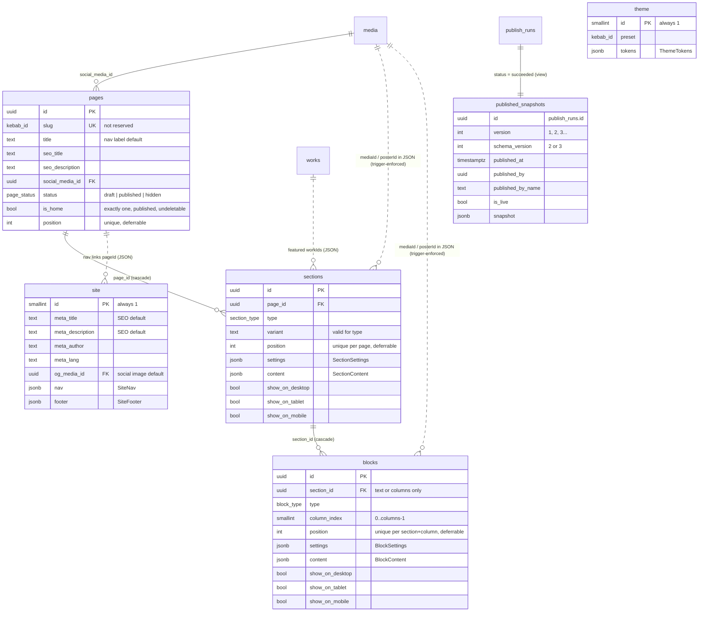

# v3 contracts

The shared contracts for the v3 visual editor (TITA-90). Every v3 child issue builds against this file. If you need to change a contract, change it here in your PR, together with `src/lib/schema-v3.ts` and a new migration, and note it on TITA-90.

- Zod contract: [`src/lib/schema-v3.ts`](../src/lib/schema-v3.ts). v2 shapes (`Site`, `Work`, `Media`) stay in `schema.ts` and are reused.
- Migrations: `supabase/migrations/20261110000100_v3_content_model.sql`, `…0200_v3_publish.sql`, `…0300_v3_migrate_v2.sql`, `…0400_v3_publish_followups.sql`. Rollbacks: `supabase/rollbacks/`.
- Tests: `supabase/tests/database/06_v3_structure`, `07_v3_rls`, `08_v3_migration`, `09_v3_restore` (pgTAP), `tests/unit/schema-v3.test.ts`, `tests/unit/loader-v3.test.ts` and the publish/restore steps in `supabase/functions/tests/functions.test.ts`.
- Fixture: `tests/fixtures/snapshot-v3.json` is the snapshot the seeded local database publishes. Use it for loader, renderer and e2e tests.

Everything in [`V2-CONTRACTS.md`](V2-CONTRACTS.md) still holds unless this file says otherwise: auth, editors, `is_editor()`, the activity log, the media library and bucket, `publish_runs`, Edge Functions, events and stats.

## 1. Model in one paragraph

A site has **pages**. A page is an ordered list of **sections**. A section has a **type** (hero, gallery, …), a **variant** (its layout), **settings** (presentation, edited in the side panel) and **content** (edited inline). The two flexible types, `text` and `columns`, also hold ordered **blocks** (heading, paragraph, …). The **theme** holds the site styles. `site.nav` and `site.footer` hold the menu and footer. Works stay as in v2 and still get their generated detail pages.

Editors write **draft** rows. **Publish** freezes them into a snapshot (**snapshot v3**, §5) in `publish_runs`. The build reads only the live snapshot through `get_published_content()`, exactly as in v2 (V2-CONTRACTS §1).

## 2. Schema



All four new tables have `created_at` (pages, sections, blocks), `updated_at` and `updated_by`, the `*_set_audit_fields` and `*_log_activity` triggers, RLS, and the `editors_all` policy (V2-CONTRACTS §9 rules).

| Table | Notes |
|---|---|
| `site` (v2, extended) | v3 reads `meta_*` and `og_media_id` as the **SEO defaults**, plus the new `nav` and `footer` JSON. `hero_*`, `about_*`, `contact_*`, `layout` and `layout_featured_works` are **v2 only**: they keep the v2 build and forms working until stage 7 retires them. Do not build v3 features on them. |
| `pages` | URL is `/CesartPortfolio/<slug>/`; the home page is served at `/CesartPortfolio/` whatever its slug (the migration names it `home`). `title` is the page name in the editor and the default nav label. `seo_*` and `social_media_id` override the site defaults. |
| `sections` | `settings` and `content` follow §3 for the section `type`. |
| `blocks` | Only inside `text` (column 0) and `columns` (columns `0..settings.columns-1`) sections. |
| `theme` | One row, `id = 1`. `tokens` follow §4. `preset` records which preset the tokens started from; it is informational. |
| `published_snapshots` | A `security_invoker` view over succeeded `publish_runs`: the version history. Editors only. |

### Enums

| Enum | Values |
|---|---|
| `page_status` | `draft` (never built), `published` (built and routable), `hidden` (taken offline, kept in the editor). Only `published` pages enter a snapshot. |
| `section_type` | `hero`, `text`, `image`, `gallery`, `featured`, `about`, `contact`, `columns`, `spacer`, `cta`, `works-list` |
| `block_type` | `heading`, `paragraph`, `image`, `button`, `divider`, `spacer`, `quote`, `video` |

### Integrity rules enforced in the database

- **Pages.** Slugs are kebab-case, ≤ 100 chars, unique, and never one of `admin, work, works, api, assets, media, preview, sitemap, robots, rss, feed, 404, index, home-preview` or starting with `_` (`RESERVED_SLUGS` in schema-v3.ts must match). Exactly one page has `is_home` (unique index, plus a deferred check at commit so the flag can move in one transaction). The home page must be `published`, and deleting it fails with `PT409`: make another page the home first.
- **Ordering.** `pages.position`, `sections (page_id, position)` and `blocks (section_id, column_index, position)` are unique and `DEFERRABLE INITIALLY DEFERRED`, so a reorder can swap positions inside one transaction (or one upsert request). Gaps are allowed.
- **Variants.** `sections_variant_valid` allows only the variants in §3 for each type (`SECTION_VARIANTS` must match; a unit test compares them).
- **Blocks.** A block in a non-flexible section, or in a column the section does not have, fails with `23514`. So does changing a section's type or lowering `settings.columns` while blocks still use those columns.
- **Media in JSON.** Every `mediaId` / `posterId` inside `sections` or `blocks` JSON must exist in `media` (`23503`), and a library file that a section or block uses cannot be deleted (`23503`), like the `on delete restrict` foreign keys of v2.
- **Size.** `settings` ≤ 32 KiB, section `content` ≤ 128 KiB, block `content` ≤ 64 KiB, `nav`/`footer` ≤ 32 KiB, `theme.tokens` ≤ 16 KiB.

**Not enforced in the database:** the deep JSON shapes (§3-4). The editor must validate every write with the `*Draft` schemas from schema-v3.ts, and the build validates the whole snapshot with `snapshotV3Schema`, so a bad shape fails the build (the publish run goes `failed` and the site stays on the previous version). References to works and pages inside JSON (`workIds`, `pageId`) are not checked either: see §5 for how the renderer treats missing ones.

## 3. Sections and blocks

### Shared shapes

| Name | Shape |
|---|---|
| `InlineText` | Array of inline nodes: `{type: "text", text, marks?}` (`text` non-empty) or `{type: "hardBreak"}`. One line of formatted text. `[]` is empty. |
| `RichText` | `{type: "doc", content: (paragraph \| heading \| bulletList \| orderedList)[]}`. See §3.4. |
| `Link` | `{kind: "page", pageId, anchor?}` (another page, by id so renames keep working) · `{kind: "work", workId}` · `{kind: "anchor", anchor}` (same page) · `{kind: "url", url, newTab?}` (`url` is a safe href, §3.4). |
| `Button` | `{label (1-60), link: Link, style: "primary" \| "secondary" (default primary)}` |
| `MediaRef` (draft) | `{mediaId, posterId?, alt?, loop?, focal?: {x, y} (0-100 %), width?, height?}`. `alt` falls back to `media.default_alt`. `width`/`height` override the library values. Video files need `posterId` (an image). |
| `Media` (snapshot) | The v2 `Media` for files: `{type: image \| animated \| video, src, alt, width, height, poster?, loop?}` plus `mediaId`, `posterId?`, `focal?`. No embeds in v3 sections (video is self-hosted only). |
| `Space` | `none \| xs \| sm \| md \| lg \| xl` (steps of the theme spacing scale) |
| `WorkSource` | `{kind: "all"}` · `{kind: "category", categoryIds}` · `{kind: "tags", tags}` · `{kind: "manual", workIds}` |
| `WorkSort` | `default` (v2 order: `order`, then newest year, then title) · `newest` · `oldest` · `title` |

### 3.1 Section settings shared by every type

All optional: `anchor` (kebab id, becomes the section `id`), `align` (`left | center | right`), `width` (`narrow | normal | wide | full`), `paddingTop` / `paddingBottom` (`Space`), `colorScheme` (`default | surface | inverse | accent`: which palette roles the section uses for background and text), `backgroundImage` (`{image: MediaRef, overlay: 0-90 %}`).

Per-device visibility is not in `settings`: it is the `show_on_desktop/tablet/mobile` columns (snapshot: `visibility`).

### 3.2 Section types

The first variant of each type is the default. `default` always means the v2 look for the types v2 had.

| Type | Variants | Settings (besides §3.1) | Content | Blocks |
|---|---|---|---|---|
| `hero` | `default` (v2: media, then text), `overlay`, `split`, `text-only` | `height?: auto \| medium \| tall \| screen`, `mediaSide?: left \| right` | `heading: InlineText`, `subheading?: InlineText`, `media?: Media`, `buttons?: Button[≤2]` | no |
| `text` | `default`, `lead`, `boxed` | — | — | yes, column 0 |
| `image` | `default` (contained), `full-bleed`, `caption-side` | `aspect?: original \| square \| landscape \| portrait`, `lightbox?: bool` | `media: Media`, `caption?: InlineText`, `link?: Link` | no |
| `gallery` | `default` (v2 masonry grid), `grid` (uniform) | `source: WorkSource`, `sort: WorkSort`, `limit?: 1-200`, `columns: {sm, md, lg: 1-6}`, `showFilters: bool` (v2 category chips), `showCaptions?: bool` | `heading?: InlineText`, `emptyText?: InlineText` | no |
| `featured` | `default` (v2), `large-first`, `strip` | `workIds: kebab[≤24]` (order kept), `limit?: 1-24` | `heading?: InlineText` | no |
| `about` | `default` (v2), `portrait-right`, `stacked` | — | `heading: InlineText`, `body: RichText`, `portrait?: Media` | no |
| `contact` | `default` (v2), `centered`, `split` | `showEmail: bool`, `showSocials: bool` | `heading: InlineText`, `body?: RichText`, `email`, `ctaLabel` (1-60) | no |
| `columns` | `default` (equal), `wide-left`, `wide-right` | `columns: 2-4` (default 2), `gap?: Space`, `stackBelow?: tablet \| mobile`, `verticalAlign?: top \| center \| bottom` | — | yes, columns `0..columns-1` |
| `spacer` | `default` | `size: Space`, `divider?: bool` | — | no |
| `cta` | `default` (the v2 "Have a project in mind?" band), `centered`, `banner` | — | `heading: InlineText`, `body?: RichText`, `buttons: Button[1-2]` | no |
| `works-list` | `default` (rows), `compact`, `cards` | `source: WorkSource`, `sort: WorkSort`, `limit?`, `showYear?`, `showCategory?`, `showThumbnail?` | `heading?: InlineText` | no |

`Media` in the table is a `MediaRef` in draft rows and a resolved `Media` in the snapshot (§5).

### 3.3 Blocks

Block `settings` (all optional, every type): `align`, `marginTop` / `marginBottom` (`Space`), `width` (`auto | full`).

| Type | Content |
|---|---|
| `heading` | `text: InlineText`, `level: 1-4` |
| `paragraph` | `text: RichText` |
| `image` | `media: Media`, `caption?: InlineText`, `link?: Link` |
| `button` | a `Button`: `label`, `link`, `style` |
| `divider` | `{}` |
| `spacer` | `size: Space` |
| `quote` | `text: InlineText`, `attribution?` (≤ 200) |
| `video` | `media: Media` (a `video` file, MP4/WebM from the library), `autoplay?: bool` (muted, looped), `controls?: bool` |

### 3.4 Rich text

Rich text is **JSON, never HTML or Markdown**, in a ProseMirror/Tiptap-compatible subset, so an MIT inline editor (Tiptap) can load and save it as is.

- Block nodes: `paragraph {content?: InlineText}`, `heading {attrs: {level: 2-4}, content?}`, `bulletList` / `orderedList {content: listItem[]}`, `listItem {content: paragraph[]}`. `h1` is not available in rich text; a page's `h1` is the hero heading or a `heading` block with level 1.
- Inline nodes: `text {text, marks?}`, `hardBreak`.
- Marks: `bold`, `italic`, `link {attrs: {href}}`. Nothing else (no underline, colour, class or style).
- **Safe href** (`SAFE_HREF` in schema-v3.ts, `public.is_safe_href()` in SQL; a unit test checks they agree): `http(s)://…`, `mailto:…`, `tel:…`, a site path `/…` that does not start with `//` or `/\` and has no backslash, or `#anchor`. Anything else (`javascript:`, `data:`, protocol-relative) fails validation. The same rule applies to `Link.url` and to links in the v2 Markdown that `md_to_richtext()` converts.
- Schemas are `.strict()`: unknown keys or node types fail.

**Renderer rules (stage 2, security review):** build elements from the nodes, escape every `text`, never use `set:html`/`dangerouslySetInnerHTML` for rich text, re-check every href against the safe-href rule at render time, and add `rel="noopener noreferrer"` to external links that open in a new tab. Site paths get the `/CesartPortfolio` base.

### 3.5 Navigation and footer (`site.nav`, `site.footer`)

```ts
SiteNav    = { items: NavItem[≤12], cta?: Button }          // cta = the header button
NavItem    = { id: kebab, label: 1-60, link: Link, children?: NavLeaf[≤10] }   // one dropdown level
NavLeaf    = { id: kebab, label: 1-60, link: Link }
SiteFooter = { text?: InlineText, links: NavLeaf[≤20], showSocials: bool,
               showCopyright: bool /* "© <year> <meta.author>. All rights reserved." */, showBackToTop: bool }
```

The header brand is `site.meta.author`, as in v2. Social links stay in the v2 `socials` table.

## 4. Theme (`theme.tokens`)

```ts
ThemeTokens = {
  colors: { light: Palette, dark: Palette | null },          // dark null = no dark mode
  typography: {
    headingFont: FontId, bodyFont: FontId,
    scale: 'small' | 'medium' | 'large',                      // medium = v2 sizes
    headingWeight: 300|400|500|600|700, bodyWeight: 300|400|500,
    lineHeight: 1.2-2, headingLineHeight: 0.9-1.6,
    letterSpacing: -0.05-0.2, headingLetterSpacing: -0.05-0.2,   // em
    headingCase: 'none' | 'uppercase',
  },
  spacing: { scale: 'compact' | 'medium' | 'roomy' },         // medium = v2 spacing
  buttons: { shape: 'square' | 'rounded' | 'pill', style: 'solid' | 'outline', textCase: 'none' | 'uppercase' },
  radius: 'none' | 'small' | 'medium' | 'large',              // medium = v2 radii
  links: { underline: 'always' | 'hover' | 'none', color: 'accent' | 'text' },
  motion: { enabled: boolean },                               // false = no reveal/hover motion for anyone
}
Palette = { background, surface, text, muted, accent, accentContrast, border, focus }   // lowercase #rrggbb
```

**Fonts** (`FONT_IDS`): `system-sans`, `system-serif` (the v2 platform stacks, no download), and the open-licence fonts `inter`, `dm-sans`, `ibm-plex-sans`, `space-grotesk`, `source-serif-4`, `lora`, `fraunces`, `playfair-display`, `ibm-plex-mono`. Stage 2 bundles them at build (self-hosted, no Google Fonts requests).

**Default (`classic`) = the v2 look**, from `src/styles/tokens.css`: the v2 light and dark palettes, `system-serif` headings at weight 400 and line height 1.1, `system-sans` body at line height 1.6, medium scale/spacing/radius, pill solid buttons, links always underlined in the text colour, motion on. `DEFAULT_THEME_TOKENS` (TS) and `default_theme_tokens()` (SQL) hold the same JSON; a unit test compares them. Stage 2 maps tokens to the existing CSS custom properties so that the default tokens produce exactly today's `tokens.css` values. Tokens that v2 does not expose (overlay colours, shadows, z-indexes) stay fixed in CSS.

`THEME_PRESETS` lists `classic`, `noir`, `paper`, `meadow` and `citrus`; their tokens are code (`src/lib/theme-presets.ts`), not rows, and every one passes WCAG AA in both palettes (`src/lib/contrast.ts`).

**Editing.** The editor writes the single `theme` row (`id = 1`) through RLS, validated with `themeTokensSchema`. Like sections and blocks, **the last write wins**: two editors changing the styles at once overwrite each other, with no conflict notice. Theme saves run after content saves and fail independently, so a refused theme never blocks content.

## 5. Publish snapshot v3

`create_publish_run()` now freezes `build_content_v3(true)`. `get_published_content()` is unchanged and returns the newest non-failed snapshot.

```jsonc
{
  "version": 3,
  "site": {
    // --- the full v2 Site (placeholder?, meta, hero, about, contact, categories, layout) ---
    // v3 code reads only placeholder, meta (SEO defaults, ogImage = default social image) and categories.
    "nav": SiteNav, "footer": SiteFooter,
    "socials": [{ "id", "label", "url" }]
  },
  "theme": { "preset": "classic", "tokens": ThemeTokens },
  "pages": [                                         // published pages only, in nav order
    {
      "id": "uuid", "slug": "home", "title": "Home", "status": "published", "isHome": true,
      "seo": { "title"?, "description"?, "ogImage"?: "bucket/key.jpg", "ogImageId"?: "uuid" },
      "sections": [                                  // in order, including sections hidden on every device
        {
          "id": "uuid", "type": "hero", "variant": "default",
          "settings": { ... }, "content": { ... },  // §3, every MediaRef resolved to a snapshot Media
          "visibility": { "desktop": true, "tablet": true, "mobile": true },
          "blocks": [                                // text/columns only; by column, then position
            { "id", "type", "column", "settings", "content", "visibility" }
          ]
        }
      ]
    }
  ],
  "works": Work[]                                    // published works, exactly as in v2
}
```

- Validate with `snapshotV3Schema` (it also checks one home page and unique slugs).
- **Transition.** `site` is a superset of the v2 `Site`, so the v2 build keeps working on a v3 snapshot until the stage-2 loader switches to v3 (`npm run test:parity` proves it). When stage 7 retires the v2 forms, a migration drops the v2-only fields from `site` and this section changes.
- **Media.** Every `MediaRef` is resolved: `src`/`poster` are bucket keys, `alt` is the ref's or the library default, `width`/`height` come from the ref or the library row. Publish fails with `PT422` if a file is missing, has no alt text or no dimensions, or a video has no poster. `snapshot_media_paths()` collects every `src`, `poster` and `ogImage` of what the build renders (`snapshot_strip_hidden()`), keeping only keys that are files in `public.media`; only those become readable by anon.
- **References the database does not check.** A nav or button `Link` to a page that is not in the snapshot, and `workIds`, `categoryIds` or `Link.workId` that are not in `works`, are **skipped by the renderer** (never a build error). The editor should warn about them.
- **Visibility.** Every section and block is in the **stored** version (`publish_runs.snapshot`, `published_snapshots`, editors only) with its `visibility`, even when it is hidden on every device, so restoring a version brings it back. Hidden-everywhere items are **never served publicly**: `get_published_content()` strips them, and their media is not in `media_paths`. The build drops the ones hidden everywhere (`withoutHidden()` in `validate-v3.ts`, before the media check) and hides the rest per breakpoint with CSS classes (no JS).
- **Preview.** `build_content_v3(false)` (editors) returns the same shape with every page (any status) and every non-archived work.

## 6. RPCs (PostgREST `POST /rest/v1/rpc/<name>`)

| Function | Caller | Does |
|---|---|---|
| `get_published_content()` | anon, authenticated | the live snapshot (now v3) **without** sections and blocks hidden on every device (`snapshot_strip_hidden()`) |
| `build_content_v3(p_published_only boolean = true)` | editor (RLS) | assembles snapshot v3 from the drafts; `false` = preview |
| `create_publish_run()` | editor | as v2 (errors `42501`, `PT409`, `PT422`), now freezing snapshot v3. Also needs a home page. |
| `restore_published_snapshot(p_run_id uuid)` | editor | copies a **v3** version back into the **draft**; it does not publish. See below. Errors: `42501` not an editor, `PT404` unknown or not succeeded, `PT422` a v2 version or it uses media deleted since. Logged as `restore` in `activity_log`. |
| `set_home_page(p_page_id uuid)` | editor (RLS) | makes the page the home page (and published), unsetting the old one. Errors: `42501`, `PT404`. |
| `section_block_columns(type, settings)` | editor | how many block columns a section offers (1 for text, `settings.columns` for columns, else 0) |
| `published_snapshots` (view, `GET /rest/v1/published_snapshots`) | editor | version history; select without `snapshot` for the list, then fetch one row's `snapshot` to preview it |
| `stats_top_pages(from, to, limit = 10)` | editor | `page_slug, title, page_views, visitors, contact_clicks` per v3 page, most viewed first (bots excluded). Errors as the other `stats_*` (`42501`, `PT422`). |

**Restore semantics** (decision recorded on TITA-91; restoring into the draft, as TITA-96 recommends):

- The theme, nav and footer become the version's.
- Every page in the version comes back with its id, slug, title, SEO and sections/blocks (same ids), as `published`, in the version's order.
- Pages that are `published` now but are not in the version become `hidden`. Nothing is deleted.
- Blocks of the version that were moved to another section since are moved back.
- `draft`/`hidden` pages that are not in the version are kept after the version's pages. If one has a slug the version needs, it is renamed `<slug>-<6 hex>`.
- Works, categories, socials, the v2 tables and the media library are not touched.
- The editor then reviews and clicks Publish as usual.

## 7. v2 → v3 migration

`migrate_v2_to_v3()` (service role) builds the v3 draft from the v2 draft tables. It runs at the end of the migration, so a hosted project with v2 content is converted on `supabase db push`. It does nothing (returns `false`) once any page exists. `seed.sql` calls it after inserting the v2 rows.

| v2 | v3 |
|---|---|
| — | `theme` row: `classic`, `default_theme_tokens()` |
| home page | page `home`, `Home`, published, `is_home` |
| layout `hero` | `hero/default`: heading, subheading, media (`MediaRef` from the hero placement; an embed hero is dropped, v3 has no embeds) |
| layout `featured` + `layout_featured_works` | `featured/default`: anchor `featured`, `workIds` in order, `limit`, heading "Featured" |
| layout `grid` | `gallery/default` (`grid` if `masonry: false`): anchor `work`, source all, sort default, v2 `columns` (default 1/2/3) and `showFilters`, heading "Work", empty text "No work in this category yet." |
| the v2 grid's commissions band | `cta/default` right after the gallery: "Have a project in mind?" + a button `contact_cta_label` → `#contact`, `paddingTop: none`; shown only when the grid and contact are both visible |
| layout `about` | `about/default`: anchor `about`, heading, `body` = `md_to_richtext(about_body)`, portrait |
| layout `contact` | `contact/default`: anchor `contact`, heading, email, ctaLabel, `showEmail`/`showSocials` true |
| `layout.visible = false` | the section is hidden on all three devices |
| v2 header links + button | `site.nav`: Work / About / Contact (for visible sections) → home page anchors; `cta` = `contact_cta_label` → `#contact`, or `mailto:` when contact is hidden |
| v2 footer | `site.footer`: copyright + back to top, no links, no socials |

`md_to_richtext()` understands the Markdown subset the v2 renderer allowed in practice: paragraphs, `#`-headings (level clamped to 2-4), `-`/`*`/`+` and `1.` lists, `**bold**`, `*italic*`/`_italic_` and `[label](href)` with a safe href. Anything else stays literal text; an unsafe link keeps only its label.

## 8. Access (RLS and grants)

| Caller | v3 rights |
|---|---|
| anon | nothing on `pages`, `sections`, `blocks`, `theme` or `published_snapshots`. Still only `get_published_content()` and `is_published_media()`. |
| signed in, not an editor | sees no rows, writes nothing, cannot restore. |
| active editor | full CRUD on the four tables, `build_content_v3`, publish, the version list, restore. Writes are attributed (`updated_by`, `activity_log`). |
| service role | everything, plus `migrate_v2_to_v3()` and the Markdown helpers. |

Storage is unchanged: drafts stay private, and only bucket keys in the live snapshot are readable by anon.

## 9. What the next stages build on

- **Stage 2, renderer (Frontend Dev).** Components per §3 type/variant and block; theme tokens → CSS custom properties (§4); rich text per §3.4; routes for published pages (§5), home at `/`; nav/footer from `site`; per-page SEO falling back to `site.meta`. Render from `tests/fixtures/snapshot-v3.json` first.
- **Stage 2, loader and publish (Backend Dev).** Read snapshot v3 with `snapshotV3Schema`; download the media in `publish_runs.media_paths`; local/CI source from a v3 JSON fixture; `publish` keeps calling `create_publish_run()`; version history = `published_snapshots`; restore = `restore_published_snapshot()`; `db:import` should call `migrate_v2_to_v3()` (service role) after importing v2 content into an empty v3 model.
- **Stages 3-6, editor (Frontend Dev).** Write rows directly through RLS like v2, validating with `sectionDraftSchema`, `blockDraftSchema`, `pageDraftSchema`, `siteNavSchema`, `siteFooterSchema` and `themeTokensSchema` first. Reorders: upsert positions in one request (the unique positions are deferred). Moving the home flag: `set_home_page(page_id)` (two updates would be two transactions over PostgREST, and the site must always have exactly one home).

## 10. Build, import and stats (TITA-93)

**Build-time loader.** `npm run build` runs `content:prepare` first:

| `CONTENT_SOURCE` | What happens |
|---|---|
| `local` (default, CI) | validates `content/site.json`, `content/works.json`, `content/snapshot-v3.json` and their files in `content/media/` |
| `supabase` | fetches `get_published_content()` with the anon key, fails unless it is `version: 3`, validates its shape, downloads every file it references (works, section and block media, background images, videos and posters, page and site social images) into `content/media/`, validates again with the files, and writes `generated/content.json` |

Both then generate WebM/MP4/poster variants for every animated GIF/WebP, including section and block media (`snapshotAnimatedKeys()`). Astro reads the snapshot through `getSnapshot()` in `content.ts` (`validateSnapshotV3()`: zod shape, duplicate ids, every media file present). It never calls Supabase itself. Errors name the path, e.g. `snapshot → pages[0].sections[2].variant: …`.

**`npm run db:import`.** As in V2-CONTRACTS §8, then `migrate_v2_to_v3()` converts the imported v2 draft into the theme and the home page. It only does that while the project has no pages; after that the v3 draft belongs to the editor and the import leaves it alone. `--publish` validates `build_content_v3(true)` with `validateSnapshotV3()` and stores it as a `succeeded` run.

**`npm run test:parity`.** Builds from the local fixture and from the seeded database (the v2 seed converted by `migrate_v2_to_v3()`), checks that every v2 page (home, 404, each work) and the v2 home sections are built, and compares every HTML file. Database ids (uuids, and `s-<8 hex>-title` heading ids) are replaced by their order of first appearance before comparing, because a fresh seed never has the fixture's ids.

**Per-page stats.** `track()` adds `page` (the `<body data-page-slug>` of v3 pages; absent on work pages and the 404) to every beacon. The `track` function accepts it as kebab-case ≤ 100 chars (`400` otherwise) and stores it in `events.page_slug` (`record_event(..., p_page_slug)`). The Stats view shows a **Top pages** card from `stats_top_pages()`.

## 11. Local development and tests

Same commands as V2-CONTRACTS §9. `npm run db:reset` applies the v3 migrations and the seed (which converts the v2 seed rows and publishes a v3 snapshot). `npm run db:seed:generate` regenerates `seed.sql` and `01_seed_matches_content.test.sql`; the snapshot's v2 part must still equal `content/*.json`.

To refresh the fixture after a contract change: `npm run db:reset`, then

```sh
docker exec supabase_db_cesart-portfolio psql -U postgres -tAc "select jsonb_pretty(public.get_published_content())" > tests/fixtures/snapshot-v3.json
```

### Rules for later migrations

All V2-CONTRACTS §9 rules, plus: a new section type, variant or block type needs the enum or `sections_variant_valid` change in SQL **and** the same change in schema-v3.ts (the unit test fails otherwise), and a row in §3 here.
